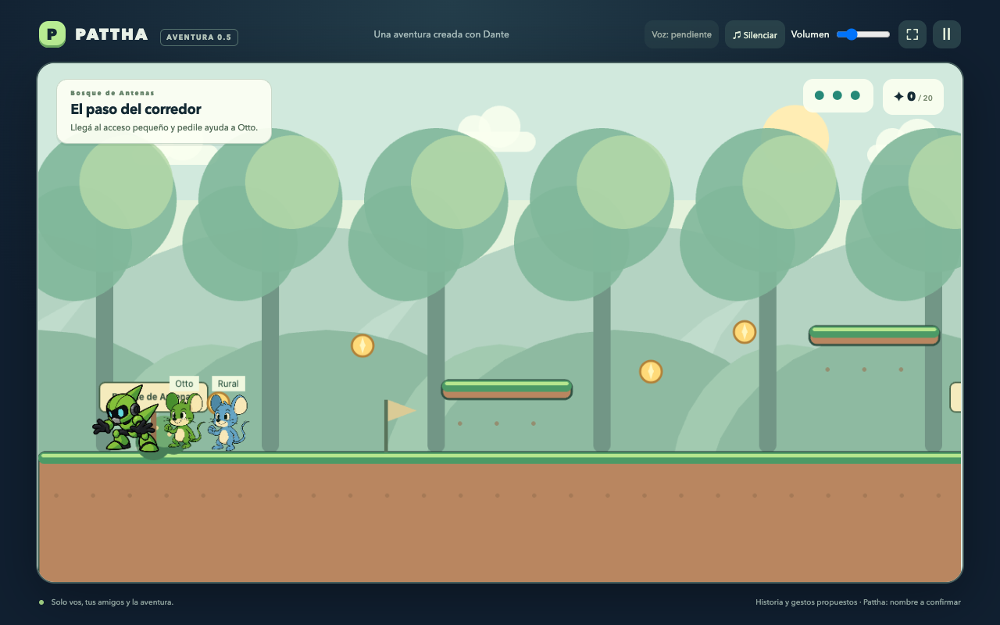
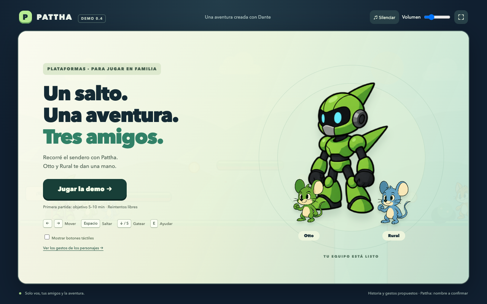

# Pattha · Aventura 0.6.0

**Dos capítulos jugables:** El sendero de los amigos y Bosque de Antenas. Nueva historia provisional, perro corredor, ayuda automática de Otto, orientación de antena con Rural y guardado local desde banderines. Solo controlás a Pattha.



## Jugar

Abrí `scripts/jugar.command` con doble clic, o ejecutá `./scripts/jugar.command` y abrí **http://localhost:5173**. Mantené abierta la ventana del servidor. Nueva aventura empieza desde el sendero; Continuar recupera el avance del navegador. Para una instalación nueva: Node 24+, pnpm 11.25.0, `pnpm install --frozen-lockfile --ignore-scripts` y `pnpm dev`.

En celular horizontal: misma Wi-Fi y `http://IP-DE-LA-COMPUTADORA:5173`. Flechas/A-D para mover, Espacio/W/↑ para saltar, ↓/S para gatear, E/Enter para Ayudar y Esc para pausar. En celular hay botones multitáctiles. Activá **Avionetas en el cielo** en el inicio o pausa para verlas también si usás reducir movimiento; la elección queda guardada en este navegador. En la [galería](http://localhost:5173/animaciones.html#sky-preview-title), **Ver pasar una avioneta** muestra un vuelo de prueba. En acertijos: tocá las formas o usá 1/2/3.

**Estado:** dos capítulos con tilesets ilustrados, interfaz azul/ámbar, Otto hueso y Rural gris oscuro. Voces del adulto todavía pendientes; subtítulos y pistas funcionan. Duración objetivo 15–20 minutos, pendiente de medir con la familia. Actualización 0.5.1 autorizada para Cloudflare; resultado de publicación en docs/PUBLICACION_CLOUDFLARE.md.

[Detalle de la entrega, guardado y controles](docs/15_AVENTURA_05.md) · [Conceptos para revisar](assets/escenarios/conceptos/bosque-antenas-v1.svg) · [Guion para grabar](docs/16_GUION_GRABACION_05.md)

## Verificar y preparar

`pnpm typecheck`, `pnpm test`, `pnpm validate:level`. Con `pnpm dev` activo: `pnpm test:campaign`, `pnpm test:browser` y `pnpm test:scenarios`. Pruebas de animación/gateo disponibles en los comandos existentes; `pnpm test:ambient` verifica las avionetas y su opción de visibilidad. Evidencia nueva en `docs/PRUEBAS_AVENTURA_05.json` y capturas `aventura-*`.

`pnpm build:site` produce `builds/web/` y `builds/site/pattha_game/`; `pnpm preview` sirve el build en http://localhost:4173. Para las voces recibidas: copiar los archivos enumerados en el guion, ejecutar `pnpm prepare:narration` y volver a construir.

Se mantienen Phaser/TypeScript/Vite, personajes, fuentes y derechos previos. Contenido activo en `data/campana.json`, `data/capitulo_sendero.json` y `data/capitulo_bosque.json`; `data/demo_plataformas.json` se conserva como antecedente. Sin datos personales, cuentas o solicitudes externas del juego; localStorage conserva exclusivamente progreso en este dispositivo.

<details>
<summary>Documentación histórica de la demo 0.4</summary>

# Demo de plataformas de Dante · 0.4

Juego familiar 2D para navegador de computadora y celular **horizontal**. Solo controlás a **Pattha**; **Otto** (verde) y **Rural** (azul) te acompañan. Nombre definitivo del juego y escritura del robot pendientes.

Repositorio dedicado: https://github.com/fueradeciclo/juego-dante

**Escenarios y puntaje:** las 30 esferas quedan en espacios libres entre plataformas y los cinco checkpoints están separados. Cada esfera suma **100 puntos**; juntarlas todas da **1.000 puntos extra al finalizar** (4.000 en total). Los valores son una propuesta ajustable. Ver [distribución, reglas y pruebas](docs/ESCENARIOS_Y_PUNTAJE_04.md).

**Nuevo:** Pattha tiene **40 cuadros**: carrera de ocho poses, salto con preparación/impulso/subida/caída/aterrizaje, gestos propios y **16 nuevas poses para agacharse, gatear y levantarse**. Deja polvo suave al despegar. En el menú, abrí **Ver los gestos de los personajes** para probar movimientos y mirar cada cuadro con Dante.

**Amigos y rivales mejorados:** Otto y Rural siguen cerca a Pattha con aceleración y frenado suaves, incluso al llegar al puente o volver. Sus charlas son ocasionales y tienen globos discretos. Pequeñas avionetas cruzan el cielo de fondo. Gatos y perros patrullan más rápido, fruncen levemente las cejas y avisan con **!** antes de avanzar. Al superarlos, cierran los ojos y desaparecen suavemente entre nubecitas. La carrera y el salto de Pattha se conservan.



## Jugar en esta computadora

Abrí `scripts/jugar.command` con doble clic o ejecutá:

```sh
./scripts/jugar.command
```

Después abrí **http://localhost:5173**. La ventana del servidor debe permanecer abierta. Ctrl+C lo detiene. El archivo también reconoce el runtime de Node/pnpm que trae Codex en esta Mac; las dependencias ya están instaladas en la carpeta de trabajo.

## Instalar desde una copia nueva

Requisitos: Node.js **24 o posterior**, pnpm **11.25.0** y un navegador moderno. No hace falta cuenta para jugar.

```sh
pnpm install --frozen-lockfile --ignore-scripts
pnpm dev
```

En un celular de la misma Wi-Fi, abrí `http://IP-DE-LA-COMPUTADORA:5173` y giralo a horizontal. Usá la IP de la computadora que corre el servidor; `localhost` en el celular apunta al propio celular. La red/firewall debe permitir el puerto 5173. Sin conexión externa necesaria para jugar una vez que se sirven los archivos.

## Controles

| Acción | Computadora | Celular horizontal |
| --- | --- | --- |
| Mover | Flechas izquierda/derecha o A/D | Botones ◀ y ▶ |
| Saltar | Espacio, W o flecha arriba | Botón Saltar |
| Agacharse/gatear | Mantener ↓ o S y avanzar con A/D o ←/→ | Mantener Gatear y ◀/▶ |
| Ayudar/interactuar | E o Enter | Botón Ayudar |
| Continuar diálogo | Enter, Espacio o botón Seguir | Botón Seguir |
| Puzzle de Rural | Formas en pantalla o teclas 1, 2, 3 | Tocá las formas |
| Pausa | Esc o botón Ⅱ | Botón Ⅱ |
| Pantalla completa | Botón ⛶, si el navegador lo permite | Igual; el bloqueo de orientación depende del navegador |

Podés mover y saltar, o gatear y avanzar, a la vez en táctil. Soltá ↓ / S o Gatear para levantarte al salir de un techo bajo. Soltar el salto acorta su altura. Hay un pequeño margen de salto al salir de un borde y una cola breve para saltos pedidos antes de aterrizar.

Saltá **encima** de gatos y perros para superarlos con un destello, o esquivalos. Los choques laterales consumen energía; al agotarse o caer volvés al último banderín. Las esferas, la tuerca y el puente se conservan durante los reintentos de esa partida. Reiniciar o recargar comienza de cero.

Hay un pasaje bajo opcional después del puente, marcado **↓ / S · Gateá**. Probá bajar, pasar y volver por el otro lado. [Set completo y comportamiento del gateo](docs/ANIMACIONES_GATEO.md).

## La demo

Tres tramos: aprender los saltos, abrir un puente con los amigos y llegar al banderín final. Hay 30 esferas opcionales y ocho rivales. Podés terminar sin recogerlas todas; la pantalla final muestra los puntos recogidos y el bonus si completás la colección. La tuerca está en la plataforma alta antes del puente; hablá con Otto y luego con Rural. La pista del puzzle permanece visible y los errores permiten reintentar.

**Objetivo de duración:** 5–10 minutos para una primera partida familiar. Pendiente medir con Dante; una persona con experiencia puede completarla antes. Sin espera artificial ni límite de intentos.

## Build y pruebas

Juego publicado: https://sabad.com.ar/pattha_game/ . Para preparar la publicación: `pnpm build:site`. La salida es `builds/site/`; la portada queda reservada para otros proyectos. Ver [configuración y estado de Cloudflare](docs/PUBLICACION_CLOUDFLARE.md). GitHub sigue siendo el lugar de trabajo; `sabad.com.ar/pattha_game/` está conectado y verificado por HTTPS.

```sh
pnpm typecheck
pnpm test
pnpm build
pnpm preview
```

`pnpm validate:level` comprueba que esferas y banderines no invadan las plataformas; también se ejecuta al construir.

El build reproducible queda en **builds/web/** y también se incluye en este repositorio por pedido familiar. `pnpm preview` lo sirve en http://localhost:4173. Serví esa carpeta por HTTP; abrir `index.html` como archivo local no es el flujo soportado.

Para integración, dejá `pnpm dev` corriendo en otra terminal y ejecutá:

```sh
pnpm test:browser
pnpm test:animations
pnpm test:pattha
pnpm test:companions
pnpm test:followers
pnpm test:crawl
pnpm test:scenarios
```

Usa un Chromium de pruebas instalado por Playwright, o una instalación existente de Chrome en una sesión aislada. Si ninguno existe: `pnpm exec playwright install chromium`. También admite `PATTHA_CHROMIUM_PATH` con una ruta al ejecutable. Nunca usa el perfil ni las cuentas del navegador personal.

Ver [pruebas y límites](docs/PRUEBAS_Y_ENTREGA.md), [resultados de integración](docs/PRUEBAS_BROWSER.json), [pruebas de animación](docs/PRUEBAS_ANIMACIONES.json) y [pruebas del nuevo Pattha](docs/PRUEBAS_PATTHA_03.json) y [pruebas de escenarios/puntaje](docs/PRUEBAS_ESCENARIOS_04.json). El adaptador para posicionar al jugador e inspeccionar sus animaciones solo se habilita en **desarrollo** con `?test=1`; no se incluye en el build.

## Estructura

```text
assets/        originales intactos, recortes y animales nuevos con procedencia
               animaciones/ contiene rigs y pattha/ las tres planchas y su atlas
data/          contenido editable; demo_plataformas.json es la demo activa
game/src/      runtime Phaser, controles, interfaz y reglas
game/tests/    pruebas de reglas de jugabilidad
scripts/       preparar assets, ejecutar y probar en navegador
docs/          canon, decisiones, avances, aceptación y capturas
builds/web/    entrega compilada de navegador
```

`game/public/` se genera copiando los assets necesarios, sin modificar las imágenes fuente. El preparador verifica los nueve checksums del manifiesto original. Los datos viejos del kit siguen como propuestas; el juego usa `data/demo_plataformas.json`.

## Canon y propuestas

**Confirmado por la familia:** protagonistas, colores, Otto y Rural; navegador horizontal; género plataformas; saltar y combatir gatos/perros; solo Pattha controlable.

**Pendiente:** grafía Pattha/Pata y variante visual definitiva. Se usa B provisoriamente, como en los datos del kit.

**Propuesta implementada para jugar y decidir:** sendero, destellos, tuerca, diálogo, cooperación del puente, señal de símbolos y combate por salto con energía y reintentos. El faro y la Gran Chispa del kit siguen como argumento opcional y no se usan en esta demo.

**Historia en desarrollo:** [línea argumental y progresión — PROPUESTA 01](docs/14_HISTORIA_Y_PROGRESION.md). Conecta el puente de la demo con una aventura para recuperar la Gran Chispa, propone un antagonista y seis niveles con rivales y cooperación progresivos. El adulto pidió desarrollar esa progresión; el argumento concreto, los nombres nuevos y las habilidades ampliadas siguen pendientes de conversación con Dante. Es un documento de diseño; no agrega niveles a la demo.

Los PNG originales del kit siguen siendo **ilustraciones estáticas intactas**. Pattha usa ahora cuatro planchas nuevas generadas a partir de B: carrera con piernas flexionadas y fases de vuelo; preparación rápida de **64 ms activos**, extensión para despegar, subida con piernas recogidas, ápice, caída con pies preparados, compresión y recuperación al aterrizar. También frena, rebota al superar un rival, ayuda y festeja. Los puntos de apoyo y la escala se alinean manteniendo el cuerpo de colisión habitual de pie. Para gatear, el cuerpo baja sin mover los pies. La altura y velocidad del salto se conservan; el salto desde un borde arranca inmediatamente.

Otto, Rural, gato y perro conservan su rig 2D por partes. Todos tienen reposo y parpadeos; tras unos **8 segundos** quietos aparece pensar, y cerca de **14 segundos**, aburrirse. Moverse cancela esos gestos. Pausa, pantalla vertical y pestaña oculta congelan las animaciones y el polvo; movimiento reducido desactiva polvo y gestos automáticos prolongados.

Las charlas de los ratones usan globos pequeños y redondeados con fondo tenue y aparición gradual. Alternan interlocutores y dan 4,4 segundos para leer cada frase. La primera charla espera 20 segundos de juego activo, y hay 60 segundos de descanso entre intercambios; cambiar de zona no acelera la siguiente. Son propuestas de diálogo en `data/demo_plataformas.json`; no requieren apretar botones ni interrumpen los saltos o el acertijo. El avance de los rivales queda dentro de su patrulla, con aviso de 480 ms y descanso posterior. La desaparición dura 900 ms de juego activo y desactiva la colisión desde el primer instante. Movimiento reducido conserva el desvanecido y evita las nubecitas, saltitos y vuelos decorativos. Ver [detalle y pruebas](docs/AMIGOS_Y_RIVALES.md).

El menú y los retratos de diálogo usan el mismo arte animado. [La galería](game/animaciones.html) se sirve como `http://localhost:5173/animaciones.html` en desarrollo o `http://localhost:4173/animaciones.html` en el build. Tiene un escenario grande para Pattha, salto completo, diez opciones de movimiento y un panel desplegable para seleccionar los 40 cuadros; debajo se comparan los cinco personajes.

Las planchas nuevas de Pattha sí contienen poses distintas; fueron creadas con **Imagegen integrada**, no dibujadas por Dante. Fuentes en [assets/animaciones/pattha/](assets/animaciones/pattha/), [prompts exactos](assets/animaciones/pattha/PROMPTS.json), atlas y checksums separados del código. El espaciado generado se corrige con recortes y pivotes en memoria; la segunda fila de carrera se refleja para unificar orientación. No se reescriben las imágenes. Ver [set de Pattha y límites](docs/ANIMACIONES_PATTHA_03.md). Los demás usan [rigs.json](assets/animaciones/rigs.json) y el [sistema de la 0.2](docs/ANIMACIONES_02.md). Gatos/perros también son ilustraciones generadas: [prompts](assets/enemigos/PROMPTS.json).

## Próxima sesión con Dante

1. Jugar en un celular real horizontal y en computadora; medir comodidad y duración.
2. Validar escritura de Pattha, variante A/B y aspecto de gatos/perros.
3. Elegir los gestos favoritos y ajustar la velocidad de la carrera, preparación del salto y apoyo de los pies. Revisar las poses derivadas de B con Dante.

No hay publicidad, compras, cuentas de jugadores, analíticas, backend ni solicitudes externas del juego. La música de fondo es «Triumph in Steel», elegida y proporcionada por la familia. Arranca al jugar: usá ♫ Silenciar y Volumen en la barra superior. Baja durante diálogos y se suspende al pausar. El MP3 se conserva en assets/audio/triumph-in-steel.mp3 y se repite completo. El juego está publicado en Cloudflare Pages; las exportaciones instalables quedan para otra decisión.

Los dibujos y personajes de Dante conservan sus derechos; este proyecto no les asigna una licencia abierta. Ver [procedencia](docs/13_CREDITOS_Y_PROCEDENCIA.md) y [licencias técnicas](docs/LICENCIAS_TECNICAS.md).

</details>
