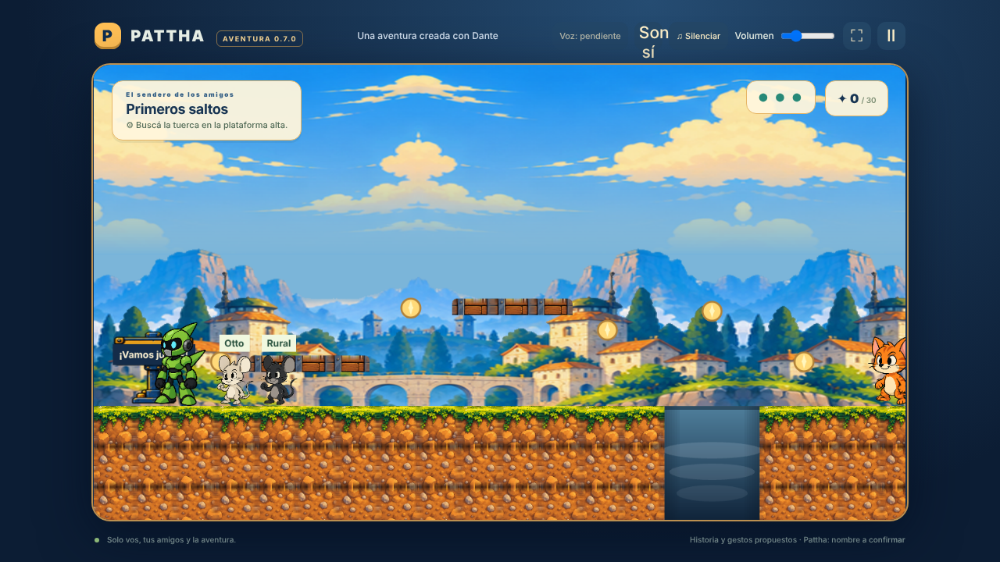

# Aventura 0.7 · Correcciones de la revisión de la 0.6.0

Pedido del adulto (2026-10-30): «Corregí todos los puntos» de la revisión de la 0.6.0. Todo lo nuevo que cambia cómo se juega es **PROPUESTA** para validar con Dante; nada de esto se atribuye a él. Personajes, colores, música y controles de Pattha no cambian.

## Lo que se ve al jugar

| Punto de la revisión | Qué se hizo |
| --- | --- |
| Pozos como rectángulo celeste liso | Cada hueco entre tramos de suelo es un barranco: degradado del color del escenario, paredes sombreadas y niebla suave. Se dibuja en el motor, sin PNG nuevos (`WorldArt.pit`). |
| Otto tapado al empezar | Más distancia de seguimiento (92 px y 162 px de Pattha, antes 72/134). Los nombres son más grandes, se desvanecen junto con los ratones y se ocultan mientras un ratón cruza por delante o detrás de Pattha. Al arrancar, los ratones empiezan adelante (Pattha está contra el borde) y lo cruzan una vez cuando empieza a caminar. |
| Botones táctiles que tapan el escenario | Semitransparentes (60 %, opacos al tocar) y un poco más chicos en pantallas bajas. Se ve el piso y los pozos detrás. |
| Textos chicos en celular | HUD, objetivo, pistas, avisos, diálogos y carteles del mundo más grandes. El objetivo empieza con un ícono (⚙ tuerca, 🐭 ratones, ★ señal, 📡 antena, ⚑ llegada). |
| Duración «15–20 min» sin respaldo | El sendero ya apuntaba a 5–10 min; el bosque declara 5–10 min como PROPUESTA. El menú dice «Objetivo 10–20 min, por medir». Falta medirlo con Dante. |

## Diseño (PROPUESTAS)

- **Antena giratoria de Rural (bosque).** Antes se elegía una de tres formas, igual que el acertijo del sendero. Ahora se gira la antena con ↺/↻ (o ←/→, 1/3) y se confirma con **Fijar antena** (o Enter/2). Nunca empieza ya resuelta. Equivocarse solo muestra «Girá y probá otra vez». La pista nombra la estrella; el texto para grabar cambió en el guion y el manifiesto de narración.
- **Otto se ve trabajando.** En el bosque camina hasta el acceso, se agacha y desaparece adentro, el interruptor chispea mientras está dentro y vuelve a salir (2,6 s de juego activo; la pausa lo congela).
- **Efectos de sonido originales**, sintetizados en el navegador sin archivos: esfera, salto, rebote sobre un rival, choque suave, banderín, tuerca, éxito, giro, reintento y fanfarria final. Botón **Sonidos: sí/no** en la barra superior.
- **Modo tranqui** (inicio o pausa): los choques solo empujan un poco y no gastan energía; si Pattha cae, vuelve al borde de donde cayó en vez del banderín. Desactivado por defecto.
- **Festejo al terminar cada capítulo:** fanfarria, confeti y saltito de Otto y Rural antes del resumen. Con «reducir movimiento» se muestra una ronda de estrellas quieta.

Las opciones Sonidos y Modo tranqui se recuerdan en el navegador (`pattha-sonidos`, `pattha-modo-tranqui`), aparte del guardado de la aventura. No se guardan datos personales.

## Técnico

- `game/src/adventure.ts` pasó de 405 líneas apretadas a funciones cortas y formateadas. La lógica de cada capítulo vive en `game/src/chapter-mechanics.ts` (`BridgeMechanic`, `AntennaMechanic`), elegida por los datos (`puente` o `antena`).
- `ChapterId` ya no es una lista fija. Los textos de victoria y del botón siguiente están en cada `data/capitulo_*.json` (`victoria`). El guardado valida por mecanismo y por orden de campaña, no por nombre de capítulo.
- El guardado se escribe cuando algo cambia (esfera, tuerca, banderín, rival, mecanismo, final), ya no en cada cuadro.
- El HUD y las pistas solo tocan la página cuando cambia el texto.
- La clave `pattha-aventura-v1` se usa desde `SAVE_KEY`.
- Los dos 404 de consola eran el pedido automático de `/favicon.ico`; ahora hay un ícono embebido.
- `builds/web/` **sigue en el repositorio** porque el documento 08 lo registra como pedido familiar. Si la familia quiere un repositorio más liviano (`.git` pesa ~65 MB), se puede dejar de versionar: Cloudflare ya construye desde la fuente.
- Node: el proyecto pide 24+. En este entorno de prueba había Node 22 y todo funcionó, con una advertencia.

Capturas: [pozo](capturas/aventura07-pozo.png) · [antena](capturas/aventura07-antena.png) · [Otto en el acceso](capturas/aventura07-otto-adentro.png) · [festejo](capturas/aventura07-festejo.png) · [celular](capturas/aventura07-movil.png).

## Pruebas

- `pnpm typecheck`, `pnpm test` (60 pruebas, 4 nuevas: antena, preferencias, efectos y capítulos por datos) y `pnpm validate:level` pasan.
- `scripts/test-campaign.mjs` y `test-campaign-build.mjs` se actualizaron para la antena giratoria.
- En el entorno donde se hizo esta versión, Chromium solo tenía WebGL por software (~11 cuadros por segundo). Las pruebas de navegador con esperas fijas fallan ahí, **también con la 0.6.0 sin cambios**. Por eso se agregó una verificación por estados (posicionar y esperar condiciones, sin tiempos fijos) que recorrió los dos capítulos completos. Sus resultados están en el diario. Conviene volver a correr `pnpm test:campaign`, `test:browser` y `test:scenarios` en una Mac con GPU antes de publicar.

## Pendiente con Dante y la familia

- Probar la 0.7 completa con Dante y anotar sus 3 mejoras (preguntas nuevas en [11_PREGUNTAS_A_DANTE.md](11_PREGUNTAS_A_DANTE.md)).
- Medir la duración real de cada capítulo.
- Escritura Pattha/Pata y título del juego.
- Aprobar o cambiar gatos/perros, antena giratoria, sonidos, modo tranqui, festejo y arte de los pozos.
- Grabar las voces (la pista del bosque cambió de texto).
- Probar en un celular físico horizontal.
- Autorizar, si corresponde, publicar la 0.7 en Cloudflare (hoy está publicada la 0.5.1).
